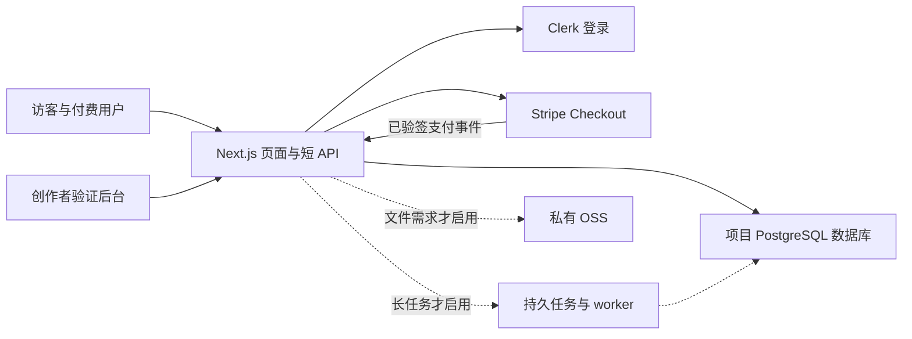

# 轻量模块与架构边界

默认只采用四个业务模块；部署和安全作为共同底座。需要更多能力时按下文条件引入 [完整架构](../paid-mvp/architecture.md)，不复制整个 altselfs 产品工程。

## 1 运行结构

默认复用 Vercel Web 托管、托管 PostgreSQL 和现有发布方式。一个项目一个逻辑数据库和受限数据库角色，可复用数据库集群；不要求每个项目新购独立数据库实例。连接池和连接上限须按托管环境配置并验收。

每个产品只有自己的数据与服务端密钥权限；预览与生产分环境。复用支付集成代码不等于允许任意项目使用同一个商户收款账户。账户归属、授权、密钥范围和收款主体须在上线前明确。

默认无 Redis、消息中间件、独立业务后端、通用 agent server 或每个项目一套浏览器服务。初期用一个版本化模板仓库固定依赖、迁移和验证记录；不另建插件市场或通用低代码引擎。

## 2 模块接口

| 模块 | 输入与输出 | 最小职责 |
| --- | --- | --- |
| `core` | 有界输入 → 核心记录 → 可使用的结果 | 一个流程、清晰错误、真实结果；付费结果由服务端限制读取 |
| `identity-data` | 登录身份 → 当前用户 → 归属校验 | 服务端验证 Clerk 身份；所有私人记录按用户和项目权限访问 |
| `purchase-delivery` | 核心记录版本 → Checkout → 订单 → 结果权限 | 服务端报价、支付确认、幂等、退款、失败恢复 |
| `validation` | 匿名来源与服务端业务事件 → 漏斗和订单视图 | 区分访问、支付、交付；汇总失败、反馈和成本 |

模块名是实现边界，不要求单独发布成包。业务只提供输入校验、结果处理、结果视图和收费对象；登录、支付事件处理与部署骨架由模板维护。

页面默认：`/` 放价值主张、示例、价格和 CTA；`/app` 放输入、结果、必要历史和账号入口；`/admin` 放创作者看板。托管认证界面复用。保存私人数据、购买或访问私人结果必须验证身份，游客草稿登录后保留。

后台只允许服务端配置的管理员身份访问。先做查看订单、查看失败、暂停新购买和打开 Stripe 订单页面；修改状态的操作记录管理员、对象、时间和原因。付款或退款状态不能由客户端或后台任意输入为“成功”。

## 3 最小数据模型

| 表 | 用途与约束 |
| --- | --- |
| `CoreRecord` | `ownerId`、输入版本、处理状态、结果、时间；购买绑定不可变版本 |
| `Order` | 用户、核心记录版本、服务端报价、支付对象 ID、支付/退款事实、交付状态；购买意图和支付对象唯一 |
| `PaymentEvent` | 供应商事件 ID 唯一、类型、关联订单、已处理时间；与本地处理在同一事务提交 |
| `ValidationEvent` | 事件 ID、时间、来源、匿名或内部用户标识、关联订单/记录；可重试事件按业务键去重 |

托管身份 ID 可直接作为 `ownerId`，无需为了登录再同步完整 `User` 表；需要资料或禁用用户的本地状态时才增加。少量反馈可作为核心记录字段保存。日志只存排障所需信息，不把完整私人输入或密钥写入分析事件。

单次购买的权益可由有效订单与核心记录的关联表达，无需另建钱包、积分账本或通用权益引擎。已退款订单停止新的付费结果访问；已经导出给用户的内容不能被技术手段收回，退款政策需符合实际交付方式。

`PaymentEvent` 是短事务处理收据，不是尚未处理事件的队列。只有本地处理全部提交后才能标记已处理；需要先接收再异步处理时，升级到完整架构的持久 inbox 和 worker。

## 4 一次性购买的最短可靠路径

1. 服务端校验身份和业务输入，保存核心记录版本，生成稳定购买意图 ID。金额、币种、商品及返回地址来自服务端配置。
2. 使用购买意图作为幂等范围创建 Checkout，绑定内部订单、用户、项目与运行环境。客户端重复点击复用该次购买，不能无意产生多个扣款。
3. Webhook 使用原始请求体验签。核对支付对象、环境、订单、金额、币种及实际支付状态；延迟支付未成功时不得交付。只凭浏览器成功跳转不授予权限。
4. 在短数据库事务中去重事件和经济事实，更新订单，授予同一记录版本的权限，写入相应验证事件。重复、并发或乱序事件不得再次授予，也不得把已退款状态覆盖为可用。
5. 事务提交后再确认事件已处理；数据库失败时返回失败供重投。前端从服务端读取真实状态，结果未就绪时明确显示处理中或失败。
6. 退款先在 Stripe Dashboard 操作，由已验签事件同步本地状态并保留退款金额。低量阶段用待处理订单列表和明确责任人做对账、重放；支付事件漏收不能依赖用户投诉才发现。

每次支付对象和业务授予都需要唯一约束，只有事件 ID 去重不足以防止不同事件重复交付。支付、退款、争议事件按实际资金状态处理，保留独立事实；有争议的订单进入人工处理，不能被迟到成功事件重新开放。无法判明外部操作是否成功时先查询状态，不能盲目重复调用收费 API。

默认的同步路径只允许快速、本地、可重试的数据库处理。耗时 AI、抓取、发送外部服务请求或生成大文件不放在支付回调事务里；持久登记任务后交给 worker。禁止用 HTTP 返回后的未等待 Promise 承担付费履约。

以上约束对应 Stripe 的 [Checkout 履约说明](https://docs.stripe.com/checkout/fulfillment) 与 [Webhook 说明](https://docs.stripe.com/webhooks)。它们是实现约束；本目录没有实现支付代码。

## 5 可省略和必须升级的能力

| 触发条件 | 加入能力 | 保留的轻量选择 |
| --- | --- | --- |
| 短、可重试、无外部副作用的处理 | 不增加 worker | 同一应用内处理，设置输入和执行时限 |
| AI/抓取等耗时或需可靠重试的付费处理 | 持久 `Job`、幂等、限并发、超时与恢复 | 复用现有 ACR/ECS worker；暂不引入额外消息集群 |
| 上传、私有附件、大结果文件 | `FileAsset`、OSS、签名访问、类型/大小限制 | 无文件需求时保存文本/JSON，浏览器打印或导出 |
| 验证假设本身是持续订阅 | 订阅生命周期、权益、取消和 Portal | 一种订阅方案；不能用单次付款证明持续留存 |
| 需要按次额度或多供应商成本结算 | 额度预留、结算、释放和账本 | 没有该需求时坚持一单一个结果 |
| 多人共享或不同成员权限 | 组织模型、成员权限与审计 | 默认只有普通用户和产品管理员 |
| 接入外部 API | 单一供应商适配、服务端密钥、预算和故障显示 | 首版不做连接器市场；确需用户账号时再提供连接入口 |

人工交付可以用于服务型 MVP，但必须在购买前写清由谁交付、结果形式和期限，并实际完成交付。不能把人工处理或示例数据展示为已运行的自动化能力。

## 6 验证看板是默认模块

固定记录：`visit` → `core_started` → `checkout_created` → `payment_confirmed` → `result_delivered`，并记录反馈、退款、失败和再次使用。流程可在契约中调整，比如先免费完成一次核心操作再收费。`payment_confirmed` 来自服务端支付确认，`result_delivered` 来自真实结果就绪与授权完成；另记 `result_viewed` 才能判断用户是否实际打开结果。

订单表是支付和退款金额的依据，分析事件丢失不能改变收入事实。去重后的访问者、购买者、订单数分别显示，不能混算。保留来源参数；无法确认来源标记 unknown；不使用侵入式指纹追踪。匿名到登录归因和数据保留规则须在隐私说明中交代。

后台默认显示六项：有效访问、开始核心操作的人数、真实付费人数、成功交付订单、退款、反馈。按首发渠道筛选即可，不先做通用图表编辑器。测试订单、管理员和已知机器人流量排除在真实转化之外；赠送和熟人支持订单单列。

成本分两栏：平台为创作者生成/托管产品的成本，以及产品每次交付消耗的成本。缺少供应商账单时显示未知或估算；支付总额减退款不是净利润，手续费和运行成本不能默认成零。

默认提供一条带来源参数的分享链接和一份可编辑首发文案。没有流量时提示“证据不足”；系统上线不等于获客完成，不自动声称验证成功或找到 PMF。

## 7 安全、成本与 100 用户容量

页面和模块可以少，以下边界不能省：服务端身份和归属校验、管理员权限、支付验签与幂等、输入校验、秘密不入前端、付费操作限流、失败可见、备份与恢复、基础日志和告警。可访问任意 URL 的业务还须防 SSRF，上传业务须限制文件类型和大小。具体规则沿用 [完整架构](../paid-mvp/architecture.md)。

预览使用测试支付和明确额度；启用真实收费前配置项目预算、单次外部调用上限、用户频率上限和暂停入口。只有确已提供的托管服务才能免去用户开户；外部服务缺少账户或额度时明确阻塞依赖功能，不能用假数据替代付费交付。

付费正式版继承完整架构的容量目标：**100 个有操作的独立在线用户**；常规 20 RPS 持续 30 分钟、50 RPS 峰值持续 2 分钟，读 p95 ≤ 800ms、写 p95 ≤ 1.2s、p99 ≤ 3s、意外错误率 < 1%。负载包含真实鉴权、查询、写入、订单查询和实际轮询模式。无任务模块时不运行任务队列场景；启用时补测执行槽、积压和恢复。

100 人在线不意味着 100 个同时运行的 AI/浏览器重任务。昂贵供应商调用单独小样本实测，框架压测用可控桩并披露；两种证据不能互相替代。可复用与模板版本、资源规格、数据库规模和访问路径都一致的基础测试证据，新增业务路径仍须验收；改变查询、鉴权、轮询、资源或执行模式时重跑对应负载。

默认恢复目标仍为 RPO ≤ 24 小时、RTO ≤ 4 小时，需托管备份和恢复演练证明。未验证容量或恢复能力时保持未验证状态；不能因模板轻量而自动宣称可承载 100 用户。
