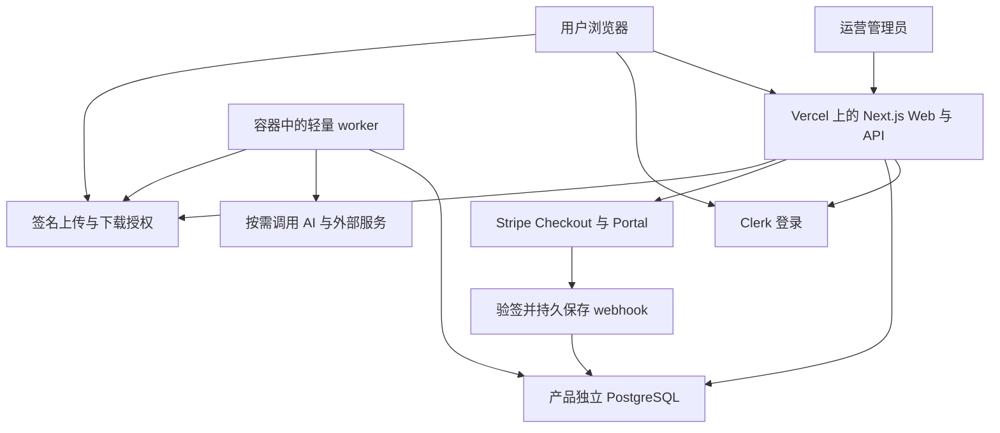

# 付费 MVP 架构与实现标准

本标准面向海外、单产品、单主要付费流程的 Web 应用。采用 altselfs 已有的 Next.js、Clerk、PostgreSQL、Stripe 和容器托管经验，缩减领域耦合及跨服务数据流。文中的 MUST 表示上线门槛，SHOULD 表示默认做法；偏离项必须在产品契约中写明原因和替代验收。

## 1 架构边界



Web 处理身份、授权、页面、CRUD、计费入口、任务提交和状态查询。Worker 处理支付事件履约、邮件、导入导出和长任务。普通 MVP 不需要把 altselfs 的完整 personal-agent-server 搬过去；将通用业务逻辑提取为服务端模块，由 Web 和 worker 共同调用。

同一个产品内，业务数据、订单、权益、任务及 outbox 默认放在同一个数据库。这样可以在一个事务里提交任务和扣减配额，或保存业务结果和待发事件。若未来确实要拆库，再采用可重放的 outbox、幂等消费和对账，不能假设跨数据库事务天然原子。

数据库、worker 和 Web 执行区域 SHOULD 接近主要用户及彼此。复用阿里云托管经验不代表新产品沿用现有国内区域；新建海外资源时要验证用户到 Web、Web 到数据库、worker 到供应商的延迟。

## 2 工程结构与依赖

建议新模板结构如下，目录为设计约定，尚未在本仓库实现：

```text
src/app/                  页面和薄 API 入口
src/components/ui/        通用界面组件
src/modules/auth/         当前身份、应用用户、权限
src/modules/billing/      Checkout、webhook、订单、订阅
src/modules/entitlements/ 权益、配额、可选积分账本
src/modules/jobs/         入队、租约、重试、取消、恢复
src/modules/storage/      文件元数据、直传、签名下载
src/modules/admin/        运营查询、纠错、审计
src/modules/product/      本产品的领域逻辑
src/lib/server/           数据库、环境变量、日志、外部请求
workers/                  轻量 Node 任务入口
prisma/                   一个迁移序列
tests/integration/        真实临时数据库上的关键不变量
tests/e2e/                浏览器业务闭环
tests/load/               固定容量场景
infra/                    发布、健康检查、回滚
product-contract.json     需求、默认项、付费点和容量
launch-evidence.json      本次发布的验收证据
```

MUST 使用 lockfile 和固定的底座版本。altselfs 本次依赖声明为 Next.js 16.2.1、React 19.2.4、Prisma 5.22 系列、Clerk 7 系列。首次提取先保持已验证组合，升级另做变更。Prisma 当前官方默认文档已经指向新版本，不能把新版本连接配置直接套到旧版本上。依据：[Prisma 连接池与版本差异](https://www.prisma.io/docs/orm/v7/prisma-client/setup-and-configuration/databases-connections/connection-pool)。

MUST 在编写 Next.js 代码前阅读已安装版本的相关指南。Route Handler 和 Server Action 内部各自校验身份及权限；`proxy.ts`、布局和前端按钮不代替数据访问授权。数据库代码留在服务端，返回显式 DTO，不能直接序列化含内部字段的 ORM 对象。依据：[Next.js 数据安全](https://nextjs.org/docs/app/guides/data-security)；本次亦核对了本地 `node_modules/next/dist/docs/`。

## 3 标准页面和产品体验

| 路由 | 必需行为 |
| --- | --- |
| `/` | 可抓取的产品说明、真实输入输出示例、价格或价格入口、开始使用 |
| `/sign-in`、`/sign-up` | 邮箱或 Google，失败提示、回跳、恢复先前输入 |
| `/app` | 核心操作、历史结果、当前状态；游客体验必须有明确边界 |
| `/app/settings` | 账户资料、账单、取消续费、数据处理或联系支持入口 |
| `/pricing` | 价格、收费周期、权益、上限、退款规则、明确 CTA |
| `/admin` | 用户、订单、任务、错误、运营操作及审计 |
| `/privacy`、`/terms`、`/contact` | 对应实际功能、商户和联系方式 |

所有关键界面 MUST 有空状态、加载、成功、失败、重试和权限不足反馈。任务产品还要显示排队、执行、取消、超时和结果恢复。用户刷新、关闭后重开、付费回跳时，不能丢失已经保存的任务。避免向产品用户暴露 worker、token、回调配置等实现细节。

MUST 验证至少桌面和手机布局、键盘操作、可见焦点、表单标签及主要按钮。Guest draft 只保存必要的非敏感内容，登录后恢复并清理。缓存键必须带用户身份或作用域，退出及换账号时清空私人缓存。

## 4 身份和数据归属

Clerk 身份是登录凭证，应用 `User.id` 是业务外键，email 是可变资料。MUST 不以邮箱、浏览器传入的 userId 或前端 role 作为授权依据。

个人产品默认 `ownerId = User.id`。所有私有业务表都有 ownerId；查询、变更、文件、任务、导出和后台详情都要检查作用域。团队协作确属第一版需求时才加入 `Workspace` 与 `Membership`，统一以 workspaceId 授权，不能把个人 ownerId 和组织 id 混用。

| 模型 | 核心约束 |
| --- | --- |
| User | 外部身份 id 唯一；启用和禁用状态；首次初始化幂等 |
| DomainObject | ownerId、状态、createdAt、updatedAt；常用 `(ownerId, createdAt, id)` 索引 |
| Payment | provider、支付对象 id、金额最小单位、币种、状态、ownerId；支付来源唯一 |
| Subscription | providerSubscriptionId 唯一、账期、状态、取消标记；仅订阅产品需要 |
| Entitlement | ownerId、功能或资源、来源订单、数量、有效期；来源授予唯一 |
| WebhookInbox | providerEventId 唯一、原事件、处理状态、租约、次数、下次重试时间 |
| Job | ownerId、业务幂等键、输入摘要、状态、attempt、leaseToken、leaseUntil、结果引用 |
| Outbox | 业务事件唯一键、状态、重试、最后错误；与业务变更同事务写入 |
| AdminAudit | actor、动作、目标、原因、脱敏变更、requestId、时间 |
| FileAsset | ownerId、objectKey、类型、大小、状态、来源任务；启用文件功能时需要 |

MUST 用唯一约束、事务及受约束状态迁移落实业务不变量。列表分页且设服务端上限，禁止无限读取聊天历史、文件和订单。数据库迁移由单独发布步骤执行，运行用户不承担 DDL 权限。

## 5 支付和权益

一次性报告或下载默认按件收费；持续提供价值的服务才选择订阅；高可变成本的 AI 服务按需增加积分账本。第一版选一种主收费方式，避免同时承诺年付、升降级、团队席位、优惠券和混合积分规则。

MUST 先区分三个事实：Stripe 支付状态、本地权益状态、产品实际履约状态。它们分别落库，可对账。支付成功页只显示服务端确认状态，不能直接授予权益。

标准流程：

1. 登录用户提交业务 purchaseAttemptId；服务端解析商品和价格，禁止接受客户端金额。
2. 保存购买意图及输入摘要，以 `(ownerId, purchaseAttemptId)` 唯一约束避免重复创建。重试相同键且不同参数应拒绝。
3. 服务端创建 Stripe Checkout，使用稳定幂等键，绑定内部订单与用户。跳转 URL 由服务端可信配置产生。
4. Webhook 用原始请求体验签，校验环境和账户作用域，持久保存 inbox 后尽快返回成功。保存失败则返回失败，让供应商重投。
5. Worker 用租约消费 inbox。在数据库事务中幂等记录付款、授予权益、创建业务任务或 outbox，再标记已处理。
6. 对乱序订阅事件读取供应商当前对象并串行协调本地投影，避免旧快照覆盖新状态；不要只依赖事件时间戳排序。
7. 重试耗尽进入可查询的失败队列并告警。定时核对未完成订单、已支付未履约、失败 webhook 和未释放预留。

Stripe 明确说明事件可能重复、乱序，建议异步处理；底座必须用 eventId 去重，并用 invoice/payment/业务授予唯一键阻止不同事件引起重复履约。依据：[Stripe webhook](https://docs.stripe.com/webhooks)。

| 场景 | 必须验证的结果 |
| --- | --- |
| 重复点击购买、网络超时后重试 | 同一购买意图复用；没有重复授予 |
| 同一回调并发重放 10 次 | 一条经济事实、一次权益授予 |
| 支付成功但用户不回跳 | 仍然完成履约 |
| 延迟支付、失败支付、放弃 Checkout | 仅确认成功的付款获得权益 |
| 订阅续费、到期取消、付款失败 | 权益按约定账期变化，不依赖页面刷新 |
| 退款、部分退款、拒付 | 按购买时规则撤销或冻结权益，金额与额度可追溯 |
| Stripe 成功而本地写入失败 | 通过回调重投和对账恢复，不能重新扣费 |

不支持的商业变更必须在产品配置和 Stripe Portal 中共同禁用。税务设置、商户资格和退款条款由实际经营主体确认，不能把接入 Stripe 等同于这些事项已完成。

积分是可选模块。需要时继承 altselfs 的预留、结算、释放、批次及账本设计，但必须增加每次任务最大消费或分阶段授权。一个小额 hold 只是并发准入，不是实际成本上限。不要默认复制当前“最后一次操作可导致负余额”的业务策略。

## 6 异步任务和故障恢复

大约 10 秒以上、时长不确定、有多次外部调用或需要关闭页面后继续的工作 SHOULD 入队。提交事务持久化 Job、权益预留及 outbox，返回 `202 + jobId`；浏览器使用有退避的轮询或可重连事件流，状态来源始终是数据库。

状态约定：`QUEUED → RUNNING → SUCCEEDED / FAILED / CANCELLED`；暂时错误转 `RETRY_WAIT`；无法判断外部副作用的任务转 `NEEDS_REVIEW`。每个状态都映射明确用户反馈。

MUST 具备以下机制：

- PostgreSQL 行锁或 `FOR UPDATE SKIP LOCKED` 领取，配合全局、每用户、每供应商的容量限制和公平调度。
- 租约、心跳、超时、重试上限；过期 worker 的写入通过 leaseToken 或版本号拒绝，避免迟到结果覆盖新任务。
- 至少一次执行语义，结果及经济副作用幂等。外部 API 不支持幂等时，先查询状态或人工恢复，不得盲目重试扣款等动作。
- 取消、执行完成和结算并发时，以受约束状态迁移确定最终结果；失败预留可被对账释放。
- 业务成功和 outbox 同事务；外部通知失败不撤销已完成业务，也不假装通知成功。
- 有界队列，满载时返回可识别的 429/503 和重试提示。不能无限堆积已扣费却无法履约的工作。
- 支付及恢复任务使用独立优先级或预留槽，不能被耗时 AI 任务全部占用。

AI API 调用按需加入普通 worker。只有确需代码执行或浏览器操作时才加入隔离运行服务；禁止让业务任务直接获得宿主 Docker socket、平台密钥或其他用户目录。

## 7 100 用户容量契约

“100 用户”默认指 100 个已登录且有操作的独立用户，数据彼此隔离。它既不是 100 个注册账号，也不自动承诺 100 个同时执行的重任务。

以下是新模板验收目标，不是本次测量结果：

| 场景 | 固定负载 | 通过门槛 |
| --- | --- | --- |
| 日常交互 | 100 VU，5 秒一个请求，约 20 RPS；70% 查询、25% 普通写入、5% 账单查询 | 连续 30 分钟；读 p95 ≤ 800ms，写 p95 ≤ 1.2s，p99 ≤ 3s；意外错误率 < 1% |
| 短时峰值 | 单独用固定到达率 50 RPS 持续 2 分钟，避免响应变慢导致施压自动下降 | 无进程崩溃、连接耗尽、串号或丢写；超载时按策略拒绝 |
| 任务提交 | 100 个不同用户在 10 秒内各提交一次 | 验证过的队列容量下 100 个持久接收；接收 p95 ≤ 2s；客户端超时重试仍为同一任务 |
| 正常重任务 | 目标 5 个执行槽；参考任务平均 60 秒，输入速率 2 个/分钟 | 正常负载下排队启动 p95 ≤ 60 秒；具体完成时间按真实供应商实测 |
| 故障 | 执行时杀 worker、重复回调、重放提交、部署切换 | 租约到期后恢复或明确失败；无重复经济副作用和永久预留 |
| 越权 | A/B 两个账号交换对象、任务、文件及订单 id | 所有私有访问均拒绝；普通用户无管理员能力 |

压测使用接近生产规格的隔离环境、100 个测试身份、每用户至少 100 条业务历史和 20 条订单/权益历史；昂贵外部 API 用可控桩单独测框架吞吐，再运行少量真实依赖流程。单独报告冷启动、外部调用和负载发生器是否达到目标速率，不能把 429、超时或业务失败算成成功。

轮询也计入总负载：100 个活跃任务每 3 秒查询一次会额外产生约 33 RPS。必须随任务状态退避，并纳入测试。

容量估算采用 `执行槽数 ≥ 到达速率 × 平均服务时间 ÷ 目标利用率`。例如 5 个槽、每个任务平均 60 秒，理论满载吞吐只有 5 个任务/分钟。100 个一起入队，即使稳定执行，最后一批约需 20 分钟完成。要让 100 个任务同时执行，需要独立资源、供应商配额和成本验收。

初始轻量 worker 可从 2 vCPU、4 GiB 内存的容器资源预算开始测试，5 个主要等待外部网络的执行槽只是起点。CPU 密集、浏览器和代码沙箱必须单独测峰值 RSS、CPU、每任务成本及供应商 429；不以这组规格保证容量。

连接预算必须包含 Web 多实例、所有 worker 及其他连接池：`应用总连接预算 + 运维保留 < 数据库连接上限`。Serverless 使用连接池端点、实例内复用客户端；Prisma 的 `connection_limit=1` 限制单实例，不能代表整个系统只能服务一个用户。调大池前先观察连接等待和查询时间。依据：[Supabase 连接方式](https://supabase.com/docs/guides/database/connecting-to-postgres)。

## 8 文件与接口安全

MUST 使用服务端生成的 objectKey、大小及类型限制、短期上传凭证；上传完成后确认真实对象及归属，不能信任客户端声称的大小。下载先授权，再签名；桶默认私有，分享链接可撤销、可过期。HTML 等主动内容在独立源或受限沙箱中预览。

大文件直接进对象存储，应用只传元数据。Vercel 当前文档列出的 Function 请求和响应 payload 限制为 4.5 MB；Next.js 的 50 MB 配置不能覆盖平台限制。依据：[Vercel Functions 限制](https://vercel.com/docs/functions/limitations)。

MUST 在 API 边界统一做运行时输入校验、请求体上限、用户/IP/昂贵操作限流、身份与资源权限检查。Cookie 身份的写请求按实际框架实施 Origin/CSRF 防护；供应商 webhook 使用其签名机制。URL 获取限制协议、解析后的目标地址及每次重定向，避免访问本机、内网和云元数据地址。

密钥仅在服务端注入，区分 test/live；生产启动必须拒绝缺关键配置或管理员通配符。内部服务入口默认拒绝访问，所有业务和调试端点经过统一鉴权。日志不记录 token、完整支付载荷、用户敏感输入和带签名下载地址。

## 9 后台和可运营性

后台 MUST 支持：按用户或订单定位问题，查看付款/权益/任务各自状态，停止用户继续执行，重试安全失败任务，处理退款，纠正权益，以及查看所有操作的审计。更改金额、权益和用户状态必须记录操作者及原因；不能直接改余额而绕过账本。

同时记录产品漏斗和运行指标：访问、注册、首次核心结果、开始付款、确认付款、实际履约、退款；请求错误率/延迟、队列等待、最老待办、worker 心跳、数据库连接、webhook 延迟、对账差异、供应商成本。测试和管理员操作从商业验证数据中排除。

使用统一 requestId、userId、jobId、paymentId 关联脱敏日志。错误页面给用户可报告的 requestId。`/healthz` 证明进程活着，`/readyz` 验证接受请求所需依赖；业务探针还应执行一个真实核心动作。支付事件卡住、无 worker、恢复任务失败和预算超限必须通知运营。

## 10 发布与托管责任

MUST 提供独立 preview/staging/production 配置、迁移入口、数据库备份、恢复演练和代码回滚。发布顺序是：检查兼容迁移 → 备份/恢复点 → 迁移 → 部署不可变 Web 版本及镜像 digest → readiness → 切换流量 → 业务 smoke → drain 旧任务。旧 worker 仍可能执行时，新旧协议必须兼容。

生产迁移使用已审核的版本化 migration；禁止将 `prisma db push` 作为生产发布步骤。扩展字段先上线、历史回填后再删旧字段；代码回滚并不能自动撤销数据库变化。

新模板默认恢复目标为 RPO ≤ 24 小时、RTO ≤ 4 小时，必须通过实际备份能力和一次隔离恢复证明；需要更短丢失窗口的订单产品启用并验证 PITR。Stripe 可辅助支付对账，但不能恢复所有业务内容。

托管交付必须指定资源所有者、付款主体、域名、配置保管位置、告警接收人、月度基础设施预算、单任务/每日外部调用预算及关闭入口。费用预算是产品参数，服务套餐选择后填写真实预估；免费额度不作为生产容量保证。
